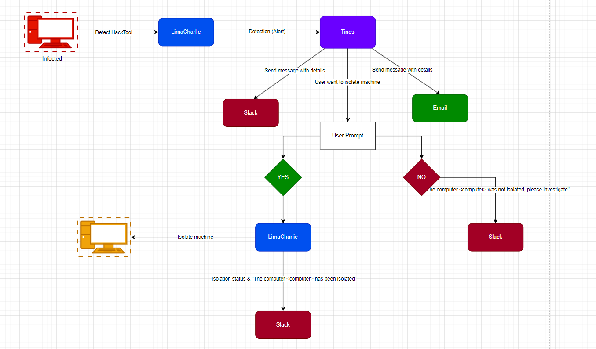

# LimaCharlie EDR and Tines SOAR Automation Lab

A hands-on SOC automation project integrating **LimaCharlie EDR** with **Tines SOAR** to detect suspicious activity on Windows endpoints, deliver alerts through Slack and email, request analyst approval, and isolate affected endpoints through the LimaCharlie REST API.

> Built in a controlled lab environment for defensive security learning, detection engineering practice, and SOC portfolio development.

---

## Project Overview

The lab monitors multiple Windows endpoints using LimaCharlie sensors and custom Detection and Response rules.

When suspicious activity is detected, LimaCharlie forwards the detection to a Tines webhook. Tines then:

1. Sends the detection details to Slack.
2. Sends the same alert by email.
3. Displays a User Prompt containing endpoint and process information.
4. Asks the analyst whether the endpoint should be isolated.
5. Calls the LimaCharlie REST API when isolation is approved.
6. Reports the isolation result back to Slack.

The workflow uses a **human-in-the-loop response model**, ensuring that containment requires analyst approval rather than being triggered automatically from a single detection.

---

## Detection Engineering & Validation Results

The original SOC automation lab has been extended with **independent detection-rule tuning, controlled test execution, and quantitative evaluation**. The two evaluated detection rules are LaZagne and Suspicious PowerShell; both include controlled lab metrics and explicit limitations.

### LaZagne: Final Paired Benchmark (v1 → v3)

| Test-level metric | v1 | v3 |
|---|---:|---:|
| True positives | 9 / 10 | 10 / 10 |
| False negatives | 1 / 10 | 0 / 10 |
| False positives | 7 / 10 | 1 / 10 |
| True negatives | 3 / 10 | 9 / 10 |
| **Detection recall** | **90%** | **100%** |
| **False positive rate** | **70%** | **10%** |

**Measured improvement:** **60 percentage points lower FPR**, and **10 percentage points higher detection recall**, over **20 paired, controlled scenarios** (10 benign + 10 positive, each evaluated against both rule versions). The unit of measurement is one execution, **not** one alert. These are targeted Windows lab tests, **not production rates**. Many positive tests reused two previously known LaZagne hashes, and an unsigned harmless executable named `LaZagne.exe` still triggered an FP.

**Review the evidence:** [Tuning report](docs/LAZAGNE_RULE_TUNING_REPORT.md) · [Final benchmark CSV](metrics/lazagne/lazagne_final_benchmark.csv) · [All tuning trials](metrics/lazagne/lazagne_tuning_test_results.csv) · [Metrics summary](metrics/lazagne/lazagne_tuning_metrics_summary.csv).

**Detection logic versions:** [v1](detection-rules/lazagne/lazagne_v1.yml) · [v2](detection-rules/lazagne/lazagne_v2.yml) · [v3](detection-rules/lazagne/lazagne_v3.yml). The archived YAML versions contain D&R **detection conditions only**; the LimaCharlie `report` response action is configured separately. The original combined rule remains at [lazagne-credential-access.yml](detection-rules/lazagne-credential-access.yml).

---

### Suspicious PowerShell: v1–v3 Rule Tuning

| Dataset | Rule | TP | FN | FP | TN | FPR | Technique recall |
|---|---|---:|---:|---:|---:|---:|---:|
| First 20 cases | v1 | 6 | 4 | 6 | 4 | **60%** | **60%** |
| **Same** first 20 | v2 | 9 | 1 | 1 | 9 | **10%** | **90%** |
| New 20 independent | v2 | 4 | 6 | 4 | 6 | 40% | 40% |
| **Same** second 20 regression | v3 | 9 | 1 | 3 | 7 | 30% | 90% |
| **Only 10/20** new v3 holdout | v3 | 3 | 2 | 2 | 3 | 40% | 60% |

**Reporting limits:** Only the first 20-case v1/v2 benchmark is a directly paired v1/v2 comparison (FPR −50 and recall +30 percentage points). The second 20 cases influenced v3 tuning, so the v3 regression is not independent. The planned v3 holdout was **not completed**. In total, **90 scored test executions** were manually recorded; they include repeated scenarios, and positives were harmless technique simulations, not confirmed attacks.

**Artifacts:** [PowerShell tuning report](docs/POWERSHELL_RULE_TUNING_REPORT.md) · [test results CSV](metrics/powershell/powershell_test_results.csv) · [metrics CSV](metrics/powershell/powershell_metrics_summary.csv) · [v1](detection-rules/powershell/powershell_v1.yml) · [v2](detection-rules/powershell/powershell_v2.yml) · [v3](detection-rules/powershell/powershell_v3.yml).

---

## Architecture



### High-Level Workflow

```text
Windows Endpoint
      |
      v
LimaCharlie Sensor
      |
      v
Custom D&R Rule
      |
      v
LimaCharlie Detection
      |
      v
Tines Webhook
  /       |        \
 v        v         v
Slack   Email   User Prompt
                    |
             +------+------+
             |             |
            YES            NO
             |             |
             v             v
  LimaCharlie Isolation   Slack
             |
             v
   Isolation Status Check
             |
             v
           Slack
```

---

## Lab Environment

| Component | Purpose |
|---|---|
| Windows analyst workstation | Manages LimaCharlie, Tines, Slack, email, and response actions |
| Windows Server 2019 VM | Endpoint used for LaZagne validation |
| Windows 10 VM | Endpoint used for detection validation and benign controls |
| LimaCharlie | Endpoint telemetry, detection rules, remote tasking, and isolation |
| Tines | Webhook ingestion, alerting, analyst approval, and response automation |
| Slack | Real-time SOC alerting and response-status notifications |
| Email | Secondary alert-delivery channel |
| VMware | Hosts the monitored Windows virtual machines |

The Windows endpoints are standalone lab systems and are not joined to an Active Directory domain.

---

## Detection Use Cases

### 1. LaZagne Credential-Access Detection

Detects execution of LaZagne using process telemetry such as:

- Executable path
- Command-line arguments
- Tool name
- Known SHA-256 hash

**Detection name:**

```text
Eric - HackTool - Lazagne (SOAR-EDR)
```

**Category:**

```text
Credential Access
```

### 2. Suspicious PowerShell Execution

Detects PowerShell processes containing suspicious execution patterns, including:

- Encoded startup arguments (`-EncodedCommand`, `-enc`, `-e`)
- Hidden window arguments (`-WindowStyle Hidden`, `-w Hidden`)
- Selected `iex` / `Invoke-Expression` invocations and `DownloadString` patterns

This is a process-command-line heuristic, not malicious script-content inspection.

**Detection name:**

```text
Eric - Suspicious PowerShell v3
```

**MITRE ATT&CK:**

```text
T1059.001 - Command and Scripting Interpreter: PowerShell
```

---

## Alert Information

The Tines workflow extracts and displays:

- Detection title
- Timestamp
- Hostname
- Internal IP address
- Username, when available
- File path
- Command line
- Sensor ID
- LimaCharlie detection link

Some LimaCharlie events do not include a username. The workflow uses:

```text
DEFAULT(
  retrieve_detections.body.detect.event.USER_NAME,
  retrieve_detections.body.detect.USER_NAME,
  "Unknown / Not provided"
)
```

This avoids empty fields without inventing attribution not present in the original telemetry.

---

## Automated Response Workflow

### Analyst Selects YES

```text
User Prompt
    |
    v
YES Condition
    |
    v
LimaCharlie Isolation API
    |
    v
Get Isolation Status
    |
    v
Slack Notification
```

A successful response is reported as:

```text
Isolation status: true
```

### Analyst Selects NO

The endpoint remains connected, and Slack records that the analyst rejected isolation.

```text
The computer <hostname> was not isolated. Please investigate.
```

---

## Safe Test Commands

> Run these commands only inside an authorized lab environment.

### Encoded PowerShell Test

```powershell
$payload = 'Write-Output "LIMACHARLIE-POWERSHELL-TEST"'

$encoded = [Convert]::ToBase64String(
    [Text.Encoding]::Unicode.GetBytes($payload)
)

powershell.exe -NoProfile -EncodedCommand $encoded
```


The LaZagne use case uses an approved lab copy of the tool on the isolated test endpoint.

---

## Repository Structure

```text
limacharlie-tines-soc-automation-lab/
├── README.md
├── architecture/
│   └── ARCHITECTURE.png
├── detection-rules/
│   ├── lazagne-credential-access.yml        # Original rule export
│   ├── lazagne/
│   │   ├── lazagne_v1.yml
│   │   ├── lazagne_v2.yml
│   │   └── lazagne_v3.yml
│   ├── suspicious-powershell.yml        # Combined v3 example
│   └── powershell/
│       ├── powershell_v1.yml
│       ├── powershell_v2.yml
│       └── powershell_v3.yml
├── metrics/
│   ├── lazagne/
│   │   ├── lazagne_final_benchmark.csv
│   │   ├── lazagne_tuning_test_results.csv
│   │   └── lazagne_tuning_metrics_summary.csv
│   └── powershell/
│       ├── README.md
│       ├── powershell_test_results.csv
│       └── powershell_metrics_summary.csv
├── docs/
│   ├── lab-environment.md
│   ├── detection-use-cases.md
│   ├── incident-response-flow.md
│   ├── testing-procedure.md
│   ├── LAZAGNE_RULE_TUNING_REPORT.md
│   └── POWERSHELL_RULE_TUNING_REPORT.md
├── evidence/
│   ├── 01-lazagne-credential-access/
│   ├── 02-suspicious-powershell/
└── tines-workflow/
    ├── workflow-overview.png
    └── workflow-sanitized.json
```

---

## Documentation

- [Lab Environment](docs/lab-environment.md)
- [Detection Use Cases](docs/detection-use-cases.md)
- [Incident Response Flow](docs/incident-response-flow.md)
- [Testing Procedure](docs/testing-procedure.md)
- [LaZagne Rule Tuning Report](docs/LAZAGNE_RULE_TUNING_REPORT.md)
- [PowerShell Rule Tuning Report](docs/POWERSHELL_RULE_TUNING_REPORT.md)
- [PowerShell Test Data](metrics/powershell/README.md)

---

## Evidence Collection

Each use case should contain a small set of sanitized screenshots showing:

1. Simulated endpoint activity
2. LimaCharlie detection
3. Slack or email alert
4. Tines User Prompt
5. Endpoint isolation result, when applicable

---

## Security and Sanitization

The public repository must not contain:

- LimaCharlie installation keys
- API keys
- Authorization headers
- Tines webhook URLs
- Slack credentials
- Personal email addresses
- LimaCharlie Organization IDs
- Sensor IDs
- External IP addresses
- Unredacted detection links
- Unsanitized Tines exports

The `workflow-sanitized.json` file should be reviewed manually before it is committed.

---

## Limitations

This is a controlled educational lab rather than a production SOC deployment.

Current limitations include:

- No Active Directory integration
- No centralized case-management platform
- Limited detection coverage
- Basic alert enrichment
- No automatic hash-reputation lookup
- No timeout or retry handling for failed isolation requests
- Rules require further tuning and allowlisting before production use

---

## Future Improvements

- Hash enrichment through VirusTotal or another reputation service
- Severity-based response routing
- Automated case creation
- Detection deduplication
- Parent-child process correlation
- LaZagne false-positive reduction through stronger behavioral context
- Optional PowerShell Script Block Logging (Event ID 4104) and telemetry/context enrichment
- Analyst identity and decision logging
- Automatic rejoin workflow
- SIEM integration

---

## Skills Demonstrated

- Endpoint Detection and Response
- Detection engineering
- Windows process telemetry analysis
- SOAR workflow development
- Webhook integration
- REST API automation
- Slack and email alerting
- Human-in-the-loop incident response
- Endpoint containment
- MITRE ATT&CK mapping
- Technical documentation

---

## Disclaimer

This project is intended solely for defensive security education and authorized lab testing.

Do not execute credential-access tools or endpoint isolation actions on systems without explicit permission.

---

## License

No `LICENSE` file has been added, so licensing terms remain unspecified.
